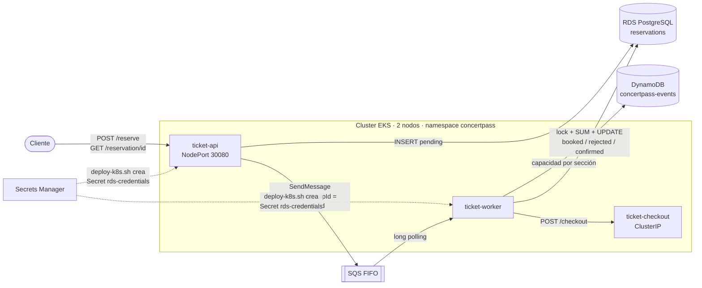

# Concertpass

Sistema de reservación de boletos para conciertos con tres microservicios en Amazon EKS. Las solicitudes
entran por una API, se encolan en SQS FIFO y un worker decide, sin sobrevender, quién obtiene boleto.



| Servicio | Tipo en k8s | Qué hace |
|---|---|---|
| `ticket-api` | Deployment (2 réplicas) + Service **NodePort** | `POST /reserve` guarda la reservación como `pending` en RDS y la encola. `GET /reservation/{id}` regresa el estado. |
| `ticket-worker` | Deployment (1 réplica, se escala a 3 en la prueba) | Consume SQS, lee la capacidad en DynamoDB, cuenta lo vendido en RDS con lock y marca `booked`/`rejected`. Llama a checkout y marca `confirmed`. |
| `ticket-checkout` | Deployment + Service ClusterIP | Simula un procesador de pagos: `POST /checkout` siempre responde `200 OK`. |

Estados: `pending → booked → confirmed`, o `pending → rejected` si no hay espacio (o el concierto/sección no existe).

## Estructura

```
concertpass/
├── ticket-api/          FastAPI · Dockerfile · src/main.py · src/schema.sql
├── ticket-worker/       Worker de SQS · Dockerfile · src/main.py · tests/stress_lock.py
├── ticket-checkout/     FastAPI · Dockerfile · src/main.py
├── k8s/                 Namespace, ConfigMap, 3 Deployments, 2 Services
├── scripts/             setup.sh, teardown.sh, creación de cada recurso y pruebas
│   └── data/concerts/   Conciertos que se precargan en DynamoDB
└── docker-compose.local.yml   Entorno local opcional (sin AWS)
```

## Requisitos

- Bash (Linux/macOS, o **Git Bash** en Windows), `aws` CLI v2, `eksctl`, `kubectl`, `docker`, `jq`, `envsubst` (gettext; viene con Git Bash) y `curl`.
- Credenciales de AWS válidas (`aws sts get-caller-identity` debe funcionar). En AWS Academy copia las credenciales de la sesión a `~/.aws/credentials` cada vez que inicies el lab (expiran a las ~4 h). Como ahí no se pueden crear roles de IAM, `create-cluster.sh` detecta el rol `LabRole` y lo usa para el cluster y los nodos (`scripts/eksctl-cluster-labrole.yaml`).
- Docker Desktop corriendo, para construir las imágenes.

Todos los scripts aceptan variables de entorno para cambiar valores por defecto (ver `scripts/config.sh`), p. ej. `AWS_REGION=us-west-2 ./setup.sh`. Por defecto se usa `us-east-1`.

## Levantar todo

```bash
cd scripts
./setup.sh        # ~30-40 min: DynamoDB, SQS, EKS, RDS, ECR (build+push) y despliegue en k8s
```

`setup.sh` llama, en orden, a estos scripts. Cada uno es idempotente y se puede correr por separado:

| Script | Crea |
|---|---|
| `create-dynamodb.sh` | Tabla `concertpass-events` (llave `concert_id`) y precarga 3 conciertos |
| `create-sqs.sh` | Cola `concertpass-reservations.fifo` (+ DLQ FIFO) |
| `create-cluster.sh` | Cluster EKS con 2 nodos `t3.medium` (`eksctl`) y kubeconfig. El rol de los nodos recibe permisos solo para esa cola y esa tabla. |
| `create-rds.sh` | PostgreSQL privado en la VPC del cluster, su security group (5432 solo desde la VPC) y el secreto `concertpass/rds-credentials` en **Secrets Manager** |
| `create-ecr.sh` | 3 repositorios ECR, build `linux/amd64` y push de las imágenes |
| `deploy-k8s.sh` | Lee el secreto de Secrets Manager → `Secret` de k8s, aplica ConfigMap y manifiestos, abre el NodePort a tu IP y prueba `/health` |

Al final verás `kubectl get nodes` con los 2 nodos `Ready` y la URL pública de `ticket-api`.

**Configuración:** los servicios leen todo de variables de entorno (`AWS_REGION`, `SQS_QUEUE_URL`,
`DYNAMODB_TABLE`, `CHECKOUT_URL`, `DB_HOST`, `DB_PORT`, `DB_NAME`, `DB_USER`, `DB_PASSWORD`); no hay valores
hardcodeados. Las de RDS vienen del Secret `rds-credentials`, que se genera desde Secrets Manager, y el resto
de la ConfigMap `concertpass-config`.

## Probar

```bash
./status.sh             # nodos, pods, services, imágenes ECR, DynamoDB, SQS y conteos en RDS

./test-low-demand.sh    # Escenario de nicho
./test-high-demand.sh   # Escenario de alta demanda
```

**Escenario de nicho** (`jazz-nicho-cdmx`): pausa el worker, envía 4 reservaciones, muestra que quedan
`pending` y que los mensajes están en SQS. Después reanuda el worker y muestra las 4 en `confirmed`, el
concierto en DynamoDB y las filas en RDS.

**Escenario de alta demanda** (`bad-bunny-gdl`, sección `vip`, capacidad 50): escala `ticket-worker` a
**3 réplicas** y envía 150 reservaciones concurrentes. Espera a que se procesen y verifica que haya
exactamente 50 boletos confirmados y 100 reservaciones `rejected`. Muestra las rechazadas en RDS y
cuántas decidió cada réplica.

Opciones: `RESET=1` borra antes las reservaciones del concierto (para repetir la prueba). También se
pueden cambiar `REQUESTS`, `PARALLEL`, `QUANTITY`, `WORKERS`, `CONCERT` y `TICKET_TYPE`.

Otras utilidades:

```bash
./db-query.sh "SELECT status, COUNT(*) FROM reservations GROUP BY status"   # psql desde un pod temporal
./reset-reservations.sh bad-bunny-gdl
kubectl -n concertpass logs -l app=ticket-worker --prefix -f
```

Llamadas manuales:

```bash
API=http://<IP-de-un-nodo>:30080
curl -X POST $API/reserve -H 'Content-Type: application/json' \
  -d '{"concert_id":"bad-bunny-gdl","user_id":"usr_123","ticket_type":"vip","quantity":2}'
curl $API/reservation/<reservation_id>
curl $API/concerts/bad-bunny-gdl/summary     # endpoint auxiliar: conteos por tipo y estado
```

## Destruir todo

```bash
./teardown.sh
```

Borra el namespace de k8s, RDS (y su subnet group y security group), el secreto, las colas SQS, la tabla
DynamoDB, los repositorios ECR y el cluster EKS (~20-25 min). Al final lista cada recurso con ✔ eliminado
o ✘ si todavía existe. **EKS y RDS cobran por hora: corre `teardown.sh` siempre que termines de trabajar.**

## Decisiones de diseño

### Cómo se evita la sobreventa

Para cada reservación, `ticket-worker` ejecuta una transacción (`try_book` en `ticket-worker/src/main.py`):

```sql
BEGIN;
SELECT pg_advisory_xact_lock(hashtext('bad-bunny-gdl:vip'));      -- 1. un worker a la vez por concierto+sección
SELECT status FROM reservations WHERE reservation_id = $1 FOR UPDATE;   -- 2. bloquea la reservación
SELECT COALESCE(SUM(quantity), 0) FROM (                           -- 3. lo vendido, con FOR UPDATE
  SELECT quantity FROM reservations
  WHERE concert_id = $2 AND ticket_type = $3 AND status IN ('booked','confirmed')
  FOR UPDATE) AS sold;
-- si sold + quantity <= capacity:
UPDATE reservations SET status = 'booked', updated_at = NOW() WHERE reservation_id = $1;
COMMIT;
-- si no: ROLLBACK, y en otra transacción solo esa fila pasa a 'rejected'
```

Hay dos diferencias con el SQL del enunciado, y las dos son necesarias:

1. **PostgreSQL no acepta `FOR UPDATE` junto con `SUM()`**: marca `ERROR: FOR UPDATE is not allowed with aggregate functions`. Por eso las filas se bloquean en una subconsulta y la suma se hace afuera.
2. **`FOR UPDATE` solo bloquea filas que ya existen y cumplen el `WHERE`.** No impide que otro worker cambie una reservación de `pending` a `booked` al mismo tiempo, ni protege la primera venta (todavía no hay filas que bloquear). El `pg_advisory_xact_lock` por `concierto:sección` serializa a todos los workers que venden la misma sección y se libera solo al hacer `COMMIT`/`ROLLBACK`.

`ticket-worker/tests/stress_lock.py` lo demuestra: 40 hilos reservan al mismo tiempo una sección con
capacidad 10. Con el lock siempre quedan 10 vendidos; sin el advisory lock (solo `FOR UPDATE`) se vendieron
14, 16 y 21 en tres corridas.

### SQS FIFO y escalamiento

- `MessageGroupId = concert_id` garantiza que las reservaciones de un concierto se procesan en orden de llegada, y `MessageDeduplicationId = reservation_id` evita duplicados.
- Mientras un grupo tiene mensajes en vuelo, SQS no entrega más mensajes de ese grupo a otro consumidor. En la prueba en EKS con 3 workers y un solo concierto, cada réplica decidió 50 de las 150 reservaciones: se turnan los lotes, pero nunca procesan el mismo concierto en paralelo. Para un concierto, más workers no aumentan el paralelismo; sí lo hacen cuando hay varios conciertos a la vez.
- `ticket-api` sí escala horizontalmente sin límite práctico: solo inserta y encola. El cuello de botella es la sección crítica de inventario (lock → suma → update), que por diseño se ejecuta de uno en uno por concierto y sección. Es el trade-off: se sacrifica concurrencia para garantizar consistencia.
- El worker es idempotente: si un mensaje se entrega dos veces, o el checkout falla y se reintenta, revisa el estado actual antes de actuar. Si algo falla, el mensaje no se borra y SQS lo reentrega; tras 5 intentos va a la DLQ.

## Desarrollo local (opcional, sin AWS)

`docker-compose.local.yml` levanta PostgreSQL, ElasticMQ (SQS) y DynamoDB Local con el mismo código:

```bash
docker compose -f docker-compose.local.yml up --build --scale ticket-worker=3
cd scripts
API_URL=http://localhost:8080 AWS_ENDPOINT_URL_DYNAMODB=http://localhost:8001 \
  AWS_ACCESS_KEY_ID=local AWS_SECRET_ACCESS_KEY=local ./test-high-demand.sh
```
